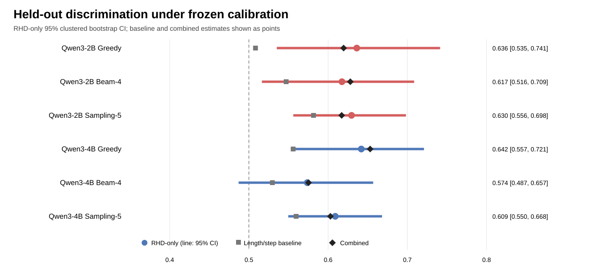
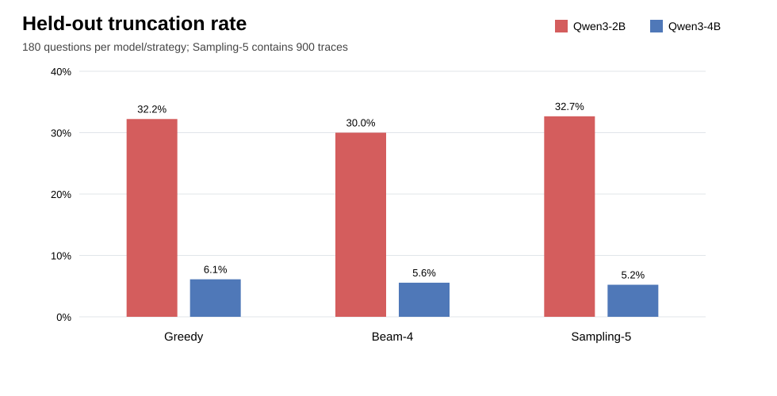

# Inter-layer reasoning-hallucination evaluation

This repository contains the reproducible generation, Reasoning Hallucination Detection
(RHD), and evaluation pipeline used in the dissertation. The confirmatory study compares
Qwen3-2B and Qwen3-4B under Greedy, Beam-4, and Sampling-5 decoding on a frozen
60-question development split and a sealed 180-question ReTruthQA held-out split. RHD is
applied after generation as a label-blind, teacher-forced diagnostic; it never changes
token selection.

Dataset identity, normalised examples, generation backends, append-only outputs,
diagnostic sidecars, frozen calibrations, and publication artifacts are kept separate so
that every reported aggregate can be traced to an immutable input and protocol version.

Run-level decisions, Slurm job identifiers, timings, failures, and result follow-ups are
recorded in [`docs/experiment-log.md`](docs/experiment-log.md). Update that log before
using a run in the dissertation so reported settings can be traced to a configuration,
code commit, and immutable output.

## Final held-out results

The pre-held-out protocol was frozen at commit [`33d155b`](https://github.com/mayflower6157/inter-layer-hallucination/commit/33d155b).
All transforms, feature directions, logistic weights, and thresholds were fitted on the
development split and then applied without refitting. Confidence intervals use 2,000
domain-stratified bootstrap replicates clustered by `sample_id`, so all five Sampling-5
traces for a question are resampled together.

| Condition | Scored | Length/step AUROC | RHD AUROC [95% CI] | Combined AUROC | Combined − baseline [95% CI] |
|---|---:|---:|---:|---:|---:|
| Qwen3-2B Greedy | 122 | 0.508 | 0.636 [0.535, 0.741] | 0.620 | **0.111 [0.016, 0.208]** |
| Qwen3-2B Beam-4 | 126 | 0.547 | 0.617 [0.516, 0.709] | 0.628 | 0.081 [−0.069, 0.229] |
| Qwen3-2B Sampling-5 | 606 | 0.582 | 0.630 [0.556, 0.698] | 0.617 | 0.036 [−0.033, 0.100] |
| Qwen3-4B Greedy | 169 | 0.556 | 0.642 [0.557, 0.721] | 0.653 | **0.097 [0.027, 0.174]** |
| Qwen3-4B Beam-4 | 169 | 0.530 | 0.574 [0.487, 0.657] | 0.575 | 0.046 [−0.047, 0.139] |
| Qwen3-4B Sampling-5 | 849 | 0.560 | 0.609 [0.550, 0.668] | 0.603 | 0.043 [−0.018, 0.104] |

The central result is conditional: development-fitted RHD features provide modest
held-out discrimination, but incremental value beyond response length and step count is
established only for Greedy decoding. The evidence does not support a decoding-invariant
or universally calibrated detector. The complete statistical statement is frozen in
[`conclusion_freeze.md`](docs/results/rhd-heldout-final-v1/conclusion_freeze.md), and the
full AUROC, AUPRC, prevalence, balanced-accuracy, and confidence-interval table is in
[`heldout_summary.md`](docs/results/rhd-heldout-final-v1/heldout_summary.md).

<p align="center">
  
</p>

### Generation, completion, and self-consistency

| Condition | Completed | Truncated | Accuracy on scored traces | Peak GPU memory (GiB) |
|---|---:|---:|---:|---:|
| Qwen3-2B Greedy | 67.8% | 32.2% | 44.3% | 3.65 |
| Qwen3-2B Beam-4 | 70.0% | 30.0% | 50.8% | 4.06 |
| Qwen3-2B Sampling-5 | 67.3% | 32.7% | 46.2% | 3.65 |
| Qwen3-4B Greedy | 93.9% | 6.1% | 45.6% | 7.70 |
| Qwen3-4B Beam-4 | 94.4% | 5.6% | 45.6% | 8.23 |
| Qwen3-4B Sampling-5 | 94.8% | 5.2% | 44.5% | 7.76 |

Sampling-5 self-consistency produced a valid majority-vote answer for 83.9% of Qwen3-2B
questions and 97.8% of Qwen3-4B questions. Accuracy over all 180 questions was 38.9% and
47.2%, respectively. Detailed publication tables are available as both CSV and LaTeX:

- [generation results](docs/results/rhd-heldout-final-v1/publication/heldout_generation_results.csv)
- [RHD operating results](docs/results/rhd-heldout-final-v1/publication/heldout_operating_results.csv)
- [domain breakdown](docs/results/rhd-heldout-final-v1/publication/heldout_domain_results.csv)
- [Sampling-5 self-consistency](docs/results/rhd-heldout-final-v1/publication/heldout_self_consistency.csv)

<p align="center">
  
</p>

The full set of paper-ready figures, tables, trajectory-selection manifests, and
provenance records is under
[`docs/results/rhd-heldout-final-v1/`](docs/results/rhd-heldout-final-v1/).

## Layout

```text
code/
├── configs/                 Development and held-out generation configurations
├── diagnostics/             RHD sidecars produced on the GPU (large files ignored)
├── evaluations/             Per-trace answer and RHD evaluations (ignored)
├── data/
│   ├── fixtures/            Committed synthetic test data
│   ├── manifests/           Versioned raw dataset manifests
│   ├── selections/          Frozen development/held-out sample IDs
│   ├── raw/                 Downloaded source data (ignored)
│   └── processed/           Reproducible derived data (ignored)
├── outputs/                 Append-only JSONL generations (ignored)
├── docs/results/
│   ├── rhd-frozen-protocol-v1/  Pre-held-out calibrations and protocol
│   └── rhd-heldout-final-v1/    Final summaries, figures, tables, and provenance
├── schemas/                 Language-independent JSON Schema contracts
├── scripts/
│   ├── analysis/            Deterministic publication and appendix renderers
│   ├── cpu/                 Dependency-light validation and smoke tests
│   └── slurm/               Cluster generation and RHD extraction jobs
├── src/dissertation_eval/
│   ├── backends/            Mock and optional Hugging Face backends
│   ├── datasets/            Manifest validation and normalized loading
│   ├── evaluation/          Answer scoring, CV, calibration, and held-out analysis
│   ├── pipeline/            Resumable generation runner
│   ├── schema.py            Canonical manifest and generation schemas
│   └── cli.py               Command-line interface
└── tests/                   Unit and end-to-end smoke tests
```

## Conda environment and installation

The recommended setup uses a dedicated Conda environment with Python 3.11. From this
directory, create and activate it with:

```bash
conda create --name dissertation-eval python=3.11 pip -y
conda activate dissertation-eval
python -m pip install --upgrade pip
pip install -e '.[dev]'
```

For Hugging Face text generation and read-only RHD extraction, install the optional
model dependencies instead:

```bash
pip install -e '.[hf,dev]'
```

On a CUDA machine, install the PyTorch build appropriate for the machine's CUDA driver
before the editable project installation. Use the command provided by the official
PyTorch installation selector rather than hard-coding a CUDA version in this project.

Verify that the environment and command-line entry point are available:

```bash
python --version
python -c "import torch; print(torch.__version__, torch.cuda.is_available())"
dissertation-eval --help
```

The `torch` verification command is required only when the `hf` dependencies are installed. Reactivate the environment in a new terminal with:

```bash
conda activate dissertation-eval
```

To remove the environment later:

```bash
conda deactivate
conda env remove --name dissertation-eval
```

## Dataset setup and manifests

A manifest records the dataset source, immutable revision, licence, field mapping,
splits, expected row counts, and SHA-256 checksums. Paths are relative to the manifest
file. Raw and processed datasets are intentionally excluded from version control;
never commit downloaded benchmark data or generated outputs.

Expected local layout:

```text
data/raw/
└── retruthqa/
    ├── R1-7B/hallucination/*.jsonl
    └── R1-14B/hallucination/*.jsonl
```

Obtain ReTruthQA from the data link in the official
[Reasoning Hallucination repository](https://github.com/Jeryi-Sun/Reasoning_Hallucination).
The committed manifest pins the source checksums and rejects a different or incomplete
release. Earlier multimodal scaffolding remains in the repository history but is not
part of the dissertation's frozen experimental scope.

Validate the immutable raw inputs:

```bash
dissertation-eval validate-manifest data/manifests/retruthqa.json
```

The ReTruthQA raw release has an unusual mixed format: R1-7B files are JSONL, while
R1-14B files are JSON arrays despite their `.jsonl` suffix. The manifest records the
correct parser for every split. Do not reformat the raw files because that changes
their checksums.

### ReTruthQA preparation

Generation uses a small, materialized dataset instead of extracting answers from large
reasoning traces on every run:

```bash
dissertation-eval prepare-retruthqa data/manifests/retruthqa.json \
  --output-dir data/processed/retruthqa/v1
dissertation-eval validate-prepared data/processed/retruthqa/v1
```

The extractor reads the final balanced `\boxed{...}` answer from every positive path,
normalizes it by domain, and accepts normalized consensus or a strict majority. Ties
are marked ambiguous and fail validation. Candidate votes, confidence, checksums, and
extractor version remain in the derived records and preparation manifest.

Preparation is cached by source-manifest checksum and extractor version. An unchanged
directory reports `"status": "reused"` without scanning the raw traces again. Use
`--force` only when intentionally rebuilding derived files.

### Frozen dissertation selection

The confirmatory text study uses the committed, deterministic 240-example selection in
`data/selections/retruthqa-240-v1.json`. It contains 60 development examples and 180
held-out test examples, with equal mathematics, science, and multi-hop counts in each
role. The held-out test excludes every example from the previously observed
`r1-7b_math_task1` pilot split.

Materialize and validate it from the prepared ReTruthQA v1 data with:

```bash
dissertation-eval select-retruthqa \
  data/processed/retruthqa/v1/manifest.json \
  --selection-manifest data/selections/retruthqa-240-v1.json \
  --output-dir data/processed/retruthqa/selection-240-v1
dissertation-eval validate-manifest \
  data/processed/retruthqa/selection-240-v1/manifest.json
```

If the prepared source checksum, deterministic policy, seed, or selected IDs differ
from the committed manifest, selection fails instead of silently replacing it. Generated
development/test JSONL files remain ignored because they contain benchmark prompts;
the committed ID manifest is sufficient to reproduce them from the prepared data.

## Generation records

Every attempted generation produces one JSONL record, including failures. Important
fields include:

- stable `record_id`, `run_id`, dataset/split/sample IDs and group ID;
- exact model revision, backend, decoding configuration, prompt and seed;
- reference answer and domain metadata;
- response, token IDs, finish reason, latency and peak memory;
- dataset metadata and a structured error with traceback.

The adjacent `*.run.json` file fingerprints the run configuration and environment. A
run can resume only when that fingerprint is unchanged. This prevents results from two
configurations being silently mixed.

## Local CPU validation

The `mock` backend checks the complete data-to-output path without downloading a model:

```bash
bash scripts/cpu/test_all.sh
RESET_SMOKE_OUTPUT=1 bash scripts/cpu/smoke_mock.sh
```

The committed synthetic fixture contains three small examples and is used only to validate infrastructure. Running `smoke_mock.sh` again without `RESET_SMOKE_OUTPUT=1` verifies resume behaviour: all three completed records should be skipped.

Validate all 12 ReTruthQA splits, prepare/reuse the derived dataset, and smoke-test
eight real questions with:

```bash
RESET_SMOKE_OUTPUT=1 bash scripts/cpu/smoke_retruthqa.sh
```

The smoke scripts write ignored records under `outputs/`. Re-running without
`RESET_SMOKE_OUTPUT=1` must report the records as skipped, confirming resumability.

## Reproducing the frozen experiment

The final matrix contains Qwen3-2B and Qwen3-4B crossed with Greedy, Beam-4, and
Sampling-5. Each condition has a development and held-out configuration under
`configs/`. Configuration files pin the model revision, prompt, token budget, stopping
rules, decoding parameters, selection role, output path, and run ID.

Run one condition directly on a configured GPU with, for example:

```bash
dissertation-eval generate configs/run.qwen3-2b.greedy-development.json
```

On Slurm, `submit_baseline.sh` requests one A40 for one condition. The held-out matrix
submission script creates two model lanes, with Greedy → Beam-4 → Sampling-5 dependencies
inside each lane and at most two concurrent A40 allocations:

```bash
bash scripts/slurm/submit_heldout_text_matrix.sh
```

The held-out command is recorded for reproducibility; do not rerun or alter the sealed
test merely to optimise a reported result. Running the same generation command again
skips completed `(sample_id, generation_index)` pairs. Use a new `run_id` and output path
whenever any experimental input changes.

### Answer extraction and decoding summaries

After generation, evaluate each JSONL on CPU:

```bash
dissertation-eval evaluate-retruthqa \
  outputs/qwen3-2b-greedy-development-v1.jsonl \
  --output-dir evaluations/qwen3-2b-greedy-development-v1
```

The evaluator uses the last complete balanced `\\boxed{...}` answer first and falls
back to common final-answer markers. It normalises answers by domain. Truncated and
unparseable generations remain explicit endpoints rather than being assigned invented
correctness labels. Each evaluation directory contains auditable `records.jsonl` and
`summary.json` files with the input checksum and evaluator version.

Use `compare-retruthqa` to aggregate decoding conditions and compute Sampling-5
self-consistency. For example:

```bash
dissertation-eval compare-retruthqa \
  --run greedy=outputs/qwen3-2b-greedy-test-v1.jsonl \
  --run beam4=outputs/qwen3-2b-beam4-test-v1.jsonl \
  --run sampling5=outputs/qwen3-2b-sampling5-test-v1.jsonl \
  --self-consistency sampling5 \
  --output-dir evaluations/qwen3-2b-test-decoding-v1
```

### Read-only RHD extraction

RHD is a detector, not a decoding intervention. Its layer policy, step segmentation,
four feature definitions, and pseudocode are documented in
[`docs/rhd-method-v1.md`](docs/rhd-method-v1.md). Extraction reconstructs each recorded
token sequence and performs a label-blind, teacher-forced forward pass:

```bash
python -m dissertation_eval diagnose-rhd \
  outputs/qwen3-2b-greedy-development-v1.jsonl \
  --output-dir diagnostics/rhd-qwen3-2b-greedy-development-v1 \
  --relative-layer 0.6666666667 \
  --relative-layer 0.75 \
  --relative-layer 0.8333333333 \
  --relative-layer 0.875 \
  --relative-layer 0.9166666667 \
  --relative-layer 0.9583333333
```

The command writes compressed token-level sidecars, checksums, and a run manifest. It
does not generate new responses, read benchmark labels, or modify token selection. The
same six relative layer positions are used for all conditions and mapped to absolute
layers within each model.

### Development fitting and sealed held-out evaluation

Development-only, four-fold domain-stratified cross-validation is available through:

```bash
python -m dissertation_eval cross-validate-rhd \
  evaluations/qwen3-2b-greedy-development-v1/records.jsonl \
  diagnostics/rhd-qwen3-2b-greedy-development-v1 \
  --folds 4 \
  --output-dir evaluations/rhd-qwen3-2b-greedy-development-cv-v1
```

The six final calibrations are committed under
[`docs/results/rhd-frozen-protocol-v1/calibrations/`](docs/results/rhd-frozen-protocol-v1/calibrations/).
They contain the development-fitted feature directions, means, standard deviations,
weights, and decision thresholds. The protocol was frozen before held-out inspection;
the historical pre-held-out specification and provenance are preserved in
[`rhd-frozen-protocol-v1`](docs/results/rhd-frozen-protocol-v1/).

Apply those calibrations to the six held-out evaluation/diagnostic pairs with
`evaluate-heldout-rhd`. Repeat `--condition` once per model × decoding cell:

```bash
python -m dissertation_eval evaluate-heldout-rhd \
  --condition qwen3-2b-greedy=EVAL_RECORDS,DIAGNOSTIC_DIR,CALIBRATION_JSON \
  --condition qwen3-2b-beam4=EVAL_RECORDS,DIAGNOSTIC_DIR,CALIBRATION_JSON \
  --condition qwen3-2b-sampling5=EVAL_RECORDS,DIAGNOSTIC_DIR,CALIBRATION_JSON \
  --condition qwen3-4b-greedy=EVAL_RECORDS,DIAGNOSTIC_DIR,CALIBRATION_JSON \
  --condition qwen3-4b-beam4=EVAL_RECORDS,DIAGNOSTIC_DIR,CALIBRATION_JSON \
  --condition qwen3-4b-sampling5=EVAL_RECORDS,DIAGNOSTIC_DIR,CALIBRATION_JSON \
  --bootstrap 2000 \
  --bootstrap-seed 20260924 \
  --output-dir evaluations/rhd-heldout-final-v1
```

`EVAL_RECORDS` denotes the corresponding `records.jsonl`. Sampling-5 bootstrap draws
are clustered by `sample_id`; all traces from a question move together. The command
reports AUROC, AUPRC, prevalence, balanced accuracy, domain breakdown, and paired gain
over the length/step-count baseline. No fitting or threshold selection occurs here.

### Publication artifacts

The committed summary was copied from the immutable server results and rendered with:

```bash
python scripts/analysis/render_heldout_publication.py \
  --heldout-results evaluations/rhd-heldout-final-v1/heldout_results.json \
  --development-matrix docs/results/rhd-frozen-protocol-v1/auroc_matrix.csv \
  --comparison-2b evaluations/qwen3-2b-heldout-decoding-v1/comparison.json \
  --comparison-4b evaluations/qwen3-4b-heldout-decoding-v1/comparison.json \
  --output-dir docs/results/rhd-heldout-final-v1/publication
```

The renderer deterministically produces the CSV, LaTeX, and SVG artifacts linked at
the top of this README. Detailed held-out evaluation inputs remain on the controlled
server because they contain benchmark-derived per-trace records; the aggregate result
JSON and every publication artifact are committed here. Exact source paths and output
filenames are recorded in
[`publication_manifest.json`](docs/results/rhd-heldout-final-v1/publication/publication_manifest.json),
while software/hardware versions, Slurm jobs, server-only large artifacts, and commit
identifiers are recorded in
[`provenance.md`](docs/results/rhd-heldout-final-v1/provenance.md) and
[`docs/experiment-log.md`](docs/experiment-log.md).

## Protocol invariants

1. Generation backends never read benchmark labels.
2. Prompts, token limits, parsing, and stopping rules remain matched across decoder
   comparisons unless the condition explicitly defines the difference.
3. Large RHD tensors live in immutable sidecars referenced by checksum, not in JSONL.
4. Failed and truncated generations are retained and reported; they are not selectively
   retried or assigned fabricated labels.
5. Layer choices, feature directions, normalisation, weights, and thresholds are fitted
   on development data only.
6. Held-out results are evaluated once under the frozen protocol and are not used for
   parameter selection or protocol revision.
