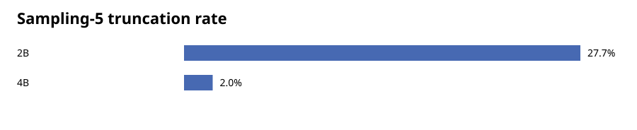
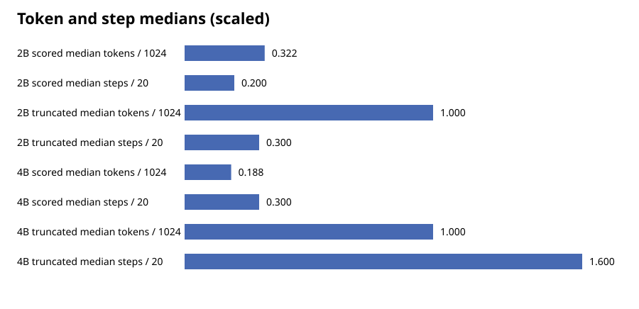
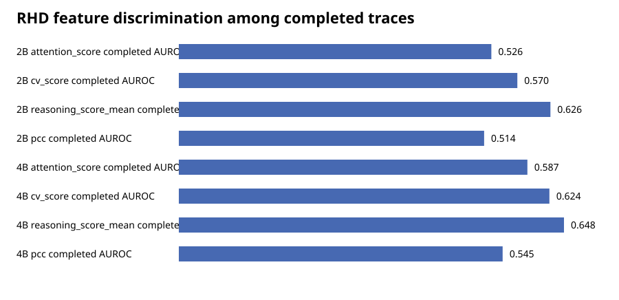

# Sampling-5 truncation and RHD selection-bias audit

Development data only. Truncated traces are treated as a separate endpoint and are never assigned correctness labels.

## Configuration sanity

Overall check: **PASS**. Both conditions use the shared Transformers backend and finish-reason implementation. Model-specific empirical stop-token IDs differ, as expected for different tokenizer vocabularies; every length termination occurs exactly at `max_new_tokens`.

| Field | 2B | 4B |
|---|---|---|
| prompt_template | `Solve the problem in at most five concise steps. Put the final answer after FINAL:.

{prompt}` | `Solve the problem in at most five concise steps. Put the final answer after FINAL:.

{prompt}` |
| decoding.strategy | `sample` | `sample` |
| decoding.max_new_tokens | `1024` | `1024` |
| decoding.temperature | `0.7` | `0.7` |
| decoding.top_p | `0.9` | `0.9` |
| decoding.num_beams | `1` | `1` |
| decoding.num_generations | `5` | `5` |
| decoding.seeds | `[101, 202, 303, 404, 505]` | `[101, 202, 303, 404, 505]` |

Empirical terminal token IDs: `{'2B': [248044], '4B': [151645]}`.

## Truncation summary

| Condition | Trace truncation | Questions with ≥1 truncation | Questions with all 5 truncated |
|---|---:|---:|---:|
| 2B | 83/300 (27.7%) | 27/60 | 9/60 |
| 4B | 6/300 (2.0%) | 2/60 | 0/60 |

## Domain and seed breakdown

### 2B

| Stratum | Truncated / n | Rate |
|---|---:|---:|
| domain=MATH | 32/100 | 32.0% |
| domain=MultiHopQA | 2/100 | 2.0% |
| domain=Science | 49/100 | 49.0% |
| seed=101 | 15/60 | 25.0% |
| seed=202 | 16/60 | 26.7% |
| seed=303 | 19/60 | 31.7% |
| seed=404 | 17/60 | 28.3% |
| seed=505 | 16/60 | 26.7% |

### 4B

| Stratum | Truncated / n | Rate |
|---|---:|---:|
| domain=MATH | 6/100 | 6.0% |
| domain=MultiHopQA | 0/100 | 0.0% |
| domain=Science | 0/100 | 0.0% |
| seed=101 | 1/60 | 1.7% |
| seed=202 | 1/60 | 1.7% |
| seed=303 | 2/60 | 3.3% |
| seed=404 | 2/60 | 3.3% |
| seed=505 | 0/60 | 0.0% |

## Token, step, and trajectory distributions

| Condition | Status | Tokens median [Q1, Q3] | Steps median [Q1, Q3] |
|---|---|---:|---:|
| 2B | scored | 330.000 [166.000, 595.000] | 4.000 [3.000, 7.000] |
| 2B | truncated | 1024.000 [1024.000, 1024.000] | 6.000 [3.000, 7.000] |
| 4B | scored | 192.000 [120.000, 361.000] | 6.000 [5.000, 10.000] |
| 4B | truncated | 1024.000 [1024.000, 1024.000] | 32.000 [24.000, 41.000] |

The paired analysis contains 300 matched `(sample_id, generation_index)` traces. The 4B-minus-2B median token difference is -207.500, and the median step difference is 2.000. Truncation contingency (2B→4B): `{'0->0': 217, '1->0': 77, '1->1': 6}`.

Normalized reference-compatible Reasoning Score trajectory (ten relative-position bins):

| Condition | Status | Bins 1–10 |
|---|---|---|
| 2B | scored | 1.024, 1.085, 1.159, 1.244, 1.232, 1.275, 1.289, 1.317, 1.257, 1.291 |
| 2B | truncated | 1.154, 1.250, 1.272, 1.282, 1.322, 1.309, 1.335, 1.322, 1.385, 1.392 |
| 4B | scored | 2.096, 2.239, 2.483, 2.397, 2.517, 2.521, 2.353, 2.386, 2.269, 2.584 |
| 4B | truncated | 2.269, 2.366, 2.462, 2.045, 2.089, 2.081, 1.892, 2.065, 1.767, 1.665 |

## Completed-trace feature discrimination

AUROC is oriented descriptively so that 0.5 is chance and larger values indicate stronger separation. Confidence intervals use clustered `sample_id` bootstrap resampling.

| Condition | Feature | AUROC | 95% CI | Truncation-endpoint AUROC |
|---|---|---:|---:|---:|
| 2B | attention_score | 0.526 | [0.420, 0.632] | 0.568 |
| 2B | cv_score | 0.570 | [0.465, 0.672] | 0.568 |
| 2B | reasoning_score_mean | 0.626 | [0.497, 0.747] | 0.563 |
| 2B | pcc | 0.514 | [0.436, 0.600] | 0.593 |
| 4B | attention_score | 0.587 | [0.492, 0.678] | 0.585 |
| 4B | cv_score | 0.624 | [0.520, 0.723] | 0.930 |
| 4B | reasoning_score_mean | 0.648 | [0.547, 0.747] | 0.951 |
| 4B | pcc | 0.545 | [0.447, 0.643] | 0.629 |

## Domain-stratified completed-trace feature AUROC

| Condition | Domain | Attention | CV | Mean-R | PCC |
|---|---|---:|---:|---:|---:|
| 2B | MATH | 0.660 | 0.587 | 0.504 | 0.650 |
| 2B | MultiHopQA | 0.526 | 0.511 | 0.548 | 0.513 |
| 2B | Science | 0.573 | 0.573 | 0.698 | 0.526 |
| 4B | MATH | 0.621 | 0.546 | 0.611 | 0.538 |
| 4B | MultiHopQA | 0.506 | 0.661 | 0.745 | 0.551 |
| 4B | Science | 0.535 | 0.686 | 0.538 | 0.598 |

## Figures

